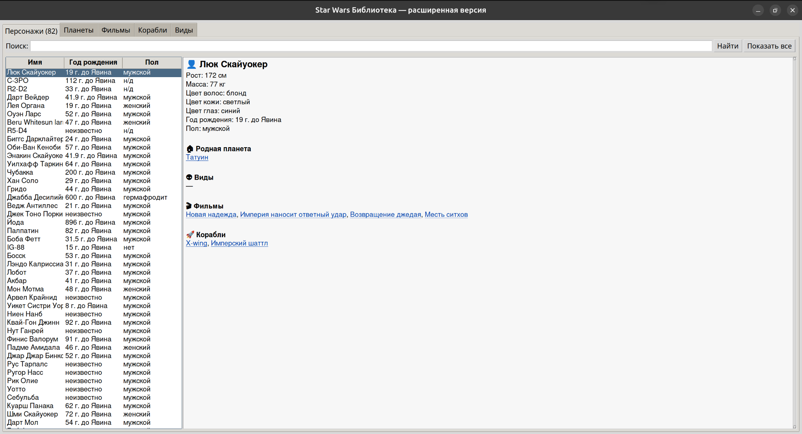

# 🌌 Star Wars Library

Интерактивная библиотека вселенной «Звёздных войн» на Python + Tkinter.
Позволяет искать персонажей, планеты, фильмы, корабли и виды, смотреть
подробную информацию и перемещаться по связям между записями.

Данные берутся из открытого API [SWAPI](https://swapi.dev/).
Интерфейс полностью на русском языке (переводы названий и полей — в `translations.py`).

---

## ✨ Возможности

- 🔍 Поиск по пяти категориям: **Персонажи, Планеты, Фильмы, Корабли, Виды**
- 📋 Кнопка «Показать все» с прогресс-баром — загружает весь датасет (82 персонажа, 60 планет и т.д.)
- 🔗 Кликабельные связи: из карточки персонажа можно перейти на его планету, фильмы, корабли — и обратно
- 🌐 Русские названия и подписи полей (цвет волос, пол, год рождения, климат, местность)
- 🧠 Кэширование запросов в памяти — повторные клики не бьют по API
- 🎨 Увеличенные отступы в таблице для читаемости

---

## 📸 Скриншот



*(добавь свой скриншот в папку `screenshots/`, иначе удали этот блок)*

---

## 🚀 Быстрый старт

### Linux (Ubuntu / Debian / Fedora / Arch)

**1. Установи Python и системные пакеты**

Ubuntu / Debian:
```bash
sudo apt update
sudo apt install -y python3 python3-pip python3-venv python3-tk
```

Fedora:
```bash
sudo dnf install -y python3 python3-pip python3-tkinter
```

Arch / Manjaro:
```bash
sudo pacman -S python python-pip tk
```

> `python3-tk` / `tkinter` — обязателен, без него `import tkinter` упадёт.
> В Ubuntu 23.04+ `pip install` глобально заблокирован, поэтому venv обязателен.

**2. Клонируй репозиторий и создай окружение**

```bash
git clone https://github.com/<твой-username>/star_wars_lib.git
cd star_wars_lib
python3 -m venv .venv
source .venv/bin/activate
```

**3. Установи зависимости и запусти**

```bash
pip install -r requirements.txt
python main.py
```

---

### Windows 10 / 11

**1. Установи Python**

Скачай установщик с [python.org/downloads](https://www.python.org/downloads/) (версия 3.8+).
При установке **обязательно поставь галочку** «Add Python to PATH».

Проверь в PowerShell или cmd:
```powershell
python --version
```

> `tkinter` входит в стандартную установку Python для Windows — отдельно ставить не нужно.

**2. Клонируй репозиторий и создай окружение**

Открой PowerShell:
```powershell
git clone https://github.com/<твой-username>/star_wars_lib.git
cd star_wars_lib
python -m venv .venv
.\.venv\Scripts\Activate.ps1
```

> Если PowerShell ругается на политику выполнения скриптов, выполни один раз:
> ```powershell
> Set-ExecutionPolicy -Scope CurrentUser -ExecutionPolicy RemoteSigned
> ```

В cmd (не PowerShell) активация выглядит иначе:
```cmd
.venv\Scripts\activate.bat
```

**3. Установи зависимости и запусти**

```powershell
pip install -r requirements.txt
python main.py
```

---

### macOS (бонус)

```bash
brew install python-tk
git clone https://github.com/<твой-username>/star_wars_lib.git
cd star_wars_lib
python3 -m venv .venv
source .venv/bin/activate
pip install -r requirements.txt
python main.py
```

---

## 🎮 Как пользоваться

1. Выбери вкладку сверху — например, **Персонажи**.
2. Введи имя в поле поиска (например, `Luke`) и нажми **Найти**.
   Поиск работает только по английским названиям — так устроен SWAPI.
3. Или нажми **Показать все**, чтобы загрузить весь список (с прогресс-баром).
4. Кликни по строке в таблице — справа появится карточка.
5. **Синие подчёркнутые слова** в карточке — кликабельны:
   клик по планете откроет вкладку «Планеты» с этой планетой,
   клик по фильму — вкладку «Фильмы» и т.д.
6. Заголовок вкладки показывает количество записей: `Персонажи (82)`.

---

## 🗂 Структура проекта

```
star_wars_lib/
├── api_client.py     # Класс SWAPI: запросы, кэш, резолвинг URL -> имя
├── models.py         # Модели Person, Planet, Film, Starship, Species
├── translations.py   # Словари русских переводов + функции
├── main.py           # Tkinter-интерфейс
└── requirements.txt
```

### Как это устроено

- **`SWAPI`** инкапсулирует все HTTP-запросы, кэширует ответы и умеет
  превращать URL-ссылки из ответов API в читаемые названия (`resolve_name`).
- **Модели** оборачивают «сырые» словари из JSON в объекты с понятными
  свойствами (`item.name`, `item.birth_year`) и защищают от отсутствующих полей.
- **`translations.py`** — три уровня перевода:
  1. Названия сущностей (`Люк Скайуокер`, `Татуин`, `Новая надежда`);
  2. Значения полей (цвета, пол, климат, местность);
  3. Год рождения: `44BBY` → `44 г. до Явина`.
- **`main.py`** строит вкладки в цикле по словарю `RESOURCE_MODELS` —
  чтобы добавить новую сущность, достаточно дописать одну строку.

---

## ⚠️ Ограничения

- **Данные только на английском в API.** SWAPI не поддерживает локализацию,
  поэтому поиск идёт по английским названиям (`Tatooine`, а не `Татуин`).
  Переводы применяются только при отображении.
- **Датасет заморожен на 2014 год.** В нём 82 персонажа, 60 планет,
  36 кораблей, 37 видов и 6 фильмов — эпизоды I–VII. Персонажей из
  «Изгоя-один», «Скайуокера» и сериалов там нет.
- **Не все имена переведены.** Если увидишь английское имя — добавь его
  в соответствующий словарь в `translations.py`. Формат:
  `"English Name": "Русское имя"`.
- **API-лимиты.** SWAPI — community-проект, не стоит спамить запросами.
  Встроенный кэш снижает нагрузку, но при массовой загрузке («Показать все»)
  делается по одному запросу на страницу.

---

## 🤝 Как контрибьютить

1. Форкни репозиторий.
2. Создай ветку: `git checkout -b feat/my-feature`.
3. Закоммить изменения: `git commit -m "add: my feature"`.
4. Запушь: `git push origin feat/my-feature`.
5. Открой Pull Request.

Особенно приветствуются дополнения в `translations.py` — там ещё есть
непереведённые второстепенные персонажи и планеты.

---

## 📜 Лицензия

MIT. Данные принадлежат Lucasfilm / Disney, API — проекту SWAPI.
Код можно свободно использовать в учебных целях.
